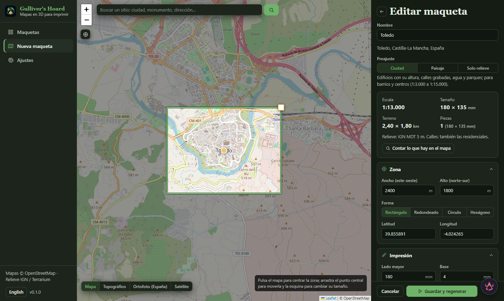

# Gulliver's Hoard

Hace maquetas 3D imprimibles de sitios reales. Eliges una zona en el mapa; la app descarga el relieve y lo que hay sobre el terreno y construye un sólido cerrado con el terreno, los edificios con su altura, lagos, ríos y mar rebajados como agua, calles y vías de tren grabadas o en relieve, parques, puentes sobre el agua y, si quieres, curvas de nivel, un marco y un texto grabado debajo. La maqueta puede ser un rectángulo, un rectángulo redondeado, un círculo o un hexágono, y se puede partir en piezas que caben en la cama de la impresora, con agujeros para pines de alineación. Sale como un STL, como un 3MF con una parte de color por filamento (terreno, edificios, agua, calles, verde, marco), un STL y un 3MF por pieza, y una vista 3D en el navegador. Es parte de la familia Hoard: funciona sola, desde Hoard Hub, desde Faustus y desde cualquier cliente MCP.

Read this in English: [README.md](README.md).




## Qué hace

- **Elegir el sitio.** Buscas por nombre (Nominatim de OpenStreetMap) y mueves la zona en el mapa (arrastras el centro, cambias el tamaño desde la esquina, pulsas para recentrar). Mapas base: OpenStreetMap, OpenTopoMap, la ortofoto PNOA del IGN para España y un satélite mundial. Lo que queda fuera de la zona se oscurece y se dibujan los cortes entre piezas.
- **Ver lo que saldrá antes de generar.** Escala (1:N), tamaño en milímetros, tamaño del terreno, piezas y su tamaño, la fuente de relieve que se usará, qué calles se dibujan a esa escala, avisos (no cabe en la cama, edificios demasiado pequeños a esa escala, malla demasiado fina) y la propuesta de piezas con un clic. «Contar lo que hay en el mapa» descarga los datos y dice cuántos edificios, calles, agua y zonas verdes hay y qué edificios destacan.
- **Tres preajustes.** Ciudad (edificios y calles, de 1:3.000 a 1:15.000 aprox.), Paisaje (más relieve, curvas de nivel, ríos y carreteras principales) y Solo relieve (terreno y agua en una pieza). Todo se puede cambiar después.
- **Relieve.** En España el MDT de 5 m del Instituto Geográfico Nacional (25 m o 200 m para zonas grandes), con Terrarium donde no llega; fuera, las teselas Terrarium (SRTM, EU-DEM, 3DEP y otras; unos 30 m en Europa, más fino en EE. UU.). La malla se suaviza según la resolución real de la fuente para que no se noten los escalones de 1 m ni las facetas de 30 m.
- **Lo que hay en el terreno.** Edificios con su altura (`height`, plantas, plantas de cubierta o una estimación por tipo), multipolígonos bien montados (un lago conserva sus islas, un edificio su patio), lagos, embalses, ríos anchos y dársenas, ríos y canales como línea, calles por tipo con su anchura real (nunca más estrechas de lo que imprime la boquilla), vías de tren y tranvía, puentes sobre el agua como tableros macizos, parques, jardines, bosques y praderas. Los túneles se omiten.
- **Un sólido imprimible.** Booleanos de verdad (manifold3d): el agua se corta a un nivel plano por tramo (los lagos quedan planos, los ríos largos bajan en escalones), los edificios se apoyan en el punto más bajo de su planta, el marco y las capas de color nunca tocan el terreno con una pared coincidente, y cada archivo se comprueba (aristas abiertas) antes de ofrecerlo.
- **Piezas.** Columnas × filas cortadas de la maqueta entera (filas con letra desde el norte, columnas con número desde el oeste, la letra grabada debajo de cada pieza), con agujeros horizontales en cada junta para pines: los de 1,9 mm admiten un trozo de filamento de 1,75 mm.
- **Color.** En modo color el 3MF lleva una parte con nombre y color por filamento (Terreno, Edificios, Agua, Carreteras, Zonas verdes, Marco); encajan exactamente y los laminadores las importan como un objeto con partes. El STL es siempre la misma maqueta en una sola pieza cerrada.
- **Vista 3D.** Órbita, planta y alzado, partes que se pueden ocultar y piezas que se separan.
- **Biblioteca.** Cada maqueta guarda sus parámetros y sus últimas generaciones; editar, regenerar, duplicar, renombrar, exportar los archivos a una carpeta o enviarlos a Vulcan's Hoard (la biblioteca de impresión 3D de la familia). El ZIP de piezas lleva un `LEEME.txt` que explica cómo se montan las piezas y los pines y qué fuentes citar.
- **Servidores de mapas saturados.** A los servidores públicos de OpenStreetMap se les pregunta en carrera escalonada y gana la primera respuesta buena; si todos están ocupados, la generación espera y lo vuelve a intentar. Las descargas se guardan en caché, así que regenerar con otros ajustes es rápido.
- **Informe.** Escala, tamaño, volumen, gramos de PLA estimados, rango de relieve, edificios dibujados, triángulos, piezas que caben en la cama, la fuente de relieve y su resolución, y el texto de atribución.

## Arrancar

```
python -m venv venv
venv\Scripts\pip install -r requirements.txt
npm install && npx vite build
venv\Scripts\python -m gulliver_hoard        # http://127.0.0.1:5206
```

`GULLIVER_FAKE=1` genera un pueblo inventado (colinas, un río con puente, un lago con isla, manzanas de edificios) sin red, para probar la interfaz. `GULLIVER_DATA_DIR` cambia la carpeta de datos (proyectos, generaciones, caché de descargas).

Sin la app: `python -m gulliver_hoard.cli --place "Toledo, España" --radius-km 1.5 --tiles 2x2 --out toledo` escribe los mismos archivos en una carpeta.

El puente MCP es `python mcp_server.py` (20 herramientas; `faustus-plugin.json` lo describe para Faustus y Hoard Hub). Con `model_create` y `lon`, `lat`, el tamaño del terreno y un preajuste basta para tener una maqueta; `area_check` contesta sin generar nada. Borrar una maqueta y vaciar la caché piden `confirm=true`.

## Familia

- Las maquetas terminadas se anuncian como `gulliver.model.ready` y, con «Guardar cada maqueta en Vulcan» activado, como `gulliver.export.done` con la ruta del 3MF: la regla `rule-exports-to-vulcan` del hub las archiva en Vulcan's Hoard con una referencia a la maqueta (`hoard://gulliver/model/<id>`). «Enviar a Vulcan» hace lo mismo a demanda (también las piezas).
- El panel de Faustus (el botón flotante de Faustus) ve lo que está abierto: las maquetas de la biblioteca, la maqueta de su página (estado, escala, tamaño, piezas, centro, tamaño del terreno) y, en los formularios de nueva maqueta y ajustes, los campos escritos y sin guardar (`gulliver:context-request`). Al terminar un turno la página recarga lo que muestra y conserva lo que estás escribiendo.

## Qué no puede hacer

- Las maquetas son tan buenas como los datos abiertos: los edificios sin `height` ni plantas en OpenStreetMap llevan una altura estimada por tipo, los tejados son planos, los monumentos son su planta extruida (sin cúpulas ni torres) y los puentes solo se dibujan sobre el agua. No usa fotogrametría ni las teselas 3D fotorrealistas de los servicios de mapas comerciales (sus condiciones prohíben hacer productos con ellas).
- Fuera de España el relieve tiene unos 30 m por muestra en casi todo el mundo: bien para paisajes, grueso para un pueblo pequeño en ladera.
- El mar es lo que está a 0 m o menos y toca el borde de la zona; los pólderes bajo el nivel del mar que tocan el borde se toman por mar. Ahí, desactiva «Mar».
- No se modelan los puentes que no cruzan agua, los pasos elevados ni los túneles (los túneles se omiten y sus calles no se graban).
- Las zonas muy grandes con edificios dependen de que respondan los servidores Overpass: cientos de km² de ciudad pueden agotar el tiempo. La malla tiene un límite de 3 millones de celdas; por encima la app pide una resolución más gruesa.
- Los colores del 3MF son nombres y colores de vista: el laminador sigue preguntando qué filamento va a cada parte.

## Desarrollo

```
python -m pytest                            # backend, contra el pueblo inventado
node --test client/copilot-context.test.mjs  # el contexto del panel
npx vite build                              # la interfaz en gulliver_hoard/static
```

Datos: relieve © Instituto Geográfico Nacional (CC BY 4.0) y Mapzen/AWS Terrain Tiles; datos del mapa © colaboradores de OpenStreetMap (ODbL). Ver [NOTICE](NOTICE). Licencia MIT.
